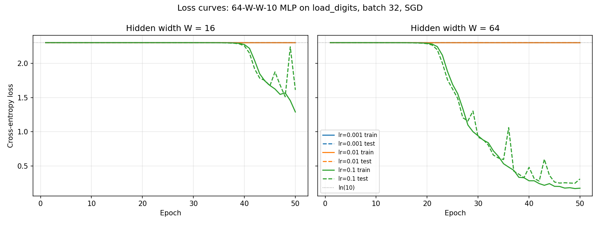

# Lab 02 — A neural network from scratch

I wrote a small neural network in plain NumPy (64 → W → ReLU → W → ReLU → 10 → softmax, with W = 16 and 64) and trained it on `load_digits`. The forward pass, the loss and backpropagation are all written by hand. To check the gradients, I nudged 10 random weights by ±1e-5 and compared the result with my analytic gradients. On the trained networks all 10 passed, with errors around 1e-10. Everything is in `src/run_lab02.py`.

| Width | lr = 0.001 | lr = 0.01 | lr = 0.1 |
|---|---|---|---|
| 16 | 10.2% | 10.2% | 50.4% |
| 64 | 10.2% | 10.2% | **90.6%** |

Only lr = 0.1 actually learned, because the initial weights (std 0.01) are so small that the lower learning rates never got the network moving. The wider network learned faster and ended up much more accurate. The backward pass took about 1.3–1.6× as long as the forward pass, because it does 5 matrix multiplications to the forward pass's 3.
