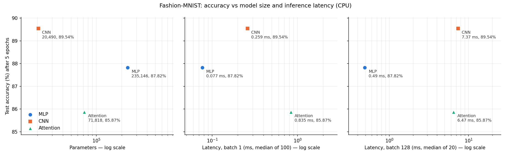

# Lab 03 — Architectures and their costs

I built an MLP, a CNN and a small patch-based Transformer in PyTorch, and trained each for 5 epochs on Fashion-MNIST (Adam, lr 1e-3, batch 128). I counted FLOPs by hand and compared them with thop. For the Linear and Conv layers the numbers matched exactly. For attention, thop missed about 96% of the work, because it has no counting rule for PyTorch's attention layer. Everything is in `src/run_lab03.py`.

| Model | Params | FLOPs / image | Latency b1 / b128 | Test accuracy |
|---|---|---|---|---|
| MLP | 235,146 | 0.47 M | 0.08 / 0.49 ms | 87.8% |
| CNN | 20,490 | 2.06 M | 0.26 / 7.37 ms | **89.5%** |
| Attention | 71,818 | 2.33 M | 0.83 / 6.47 ms | 85.9% |

The CNN was the most cost-effective: the best accuracy with 11× fewer parameters than the MLP, because each convolution filter is reused across the whole image. The MLP was the fastest on CPU, since it's basically one big matrix multiplication. The Transformer lost on every measure, because on such small inputs its many small operations add overhead, and 5 epochs wasn't enough for it to catch up.
